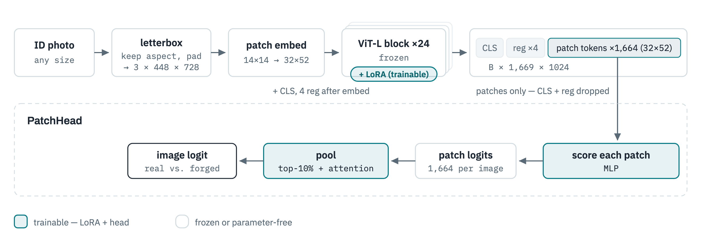

# Linear probing then fine-tuning improves out-of-distribution generalization on ViT-L but not ViT-B for identity-document fraud detection

Kumar et al. (ICLR 2022) showed that training a linear probe before fine-tuning (LP-FT)
preserves pretrained features and improves out-of-distribution (OOD) accuracy. This repo tests
that recipe on identity-document fraud detection from the
[FREUID Challenge 2026](https://www.kaggle.com/competitions/the-freuid-challenge-2026-ijcai-ecai),
where the scored set contains document types and capture methods absent from training.

**Design.** A 2×2: DINOv2 ViT-B/14 and ViT-L/14 (frozen backbone + rank-16 LoRA + patch
scoring head), each trained with plain fine-tuning (FT) and with LP-FT, one seed, identical
recipe otherwise. Evaluated on one in-distribution validation set and two OOD sets: a
generalization validation set of unseen document types, and the competition's private set,
submitted once per model.

**Result.** LP-FT helps ViT-L and hurts ViT-B, on both OOD sets. Private FREUID score (lower is
better): ViT-L 0.1253 → 0.0936, ViT-B 0.1930 → 0.2405. The effect lives in the upper tail of
genuine scores, which LP-FT pushes down on ViT-L and up on ViT-B; one shared threshold turns
that into attacks caught or missed. A one-epoch linear probe ranks the ViT-L features better,
consistent with the feature-quality condition in Kumar et al. LP-FT cuts feature movement by
17–33 % on both backbones, so the backbones differ in what the preserved features are worth,
not in how much is preserved.

## Reading order

1. [docs/paper/main.pdf](docs/paper/main.pdf) — the paper (9 pages). Source: `main.tex`, builds
   with `tectonic -X compile main.tex`.
2. [docs/WRITEUP-LPFT.md](docs/WRITEUP-LPFT.md) — the same paper in Markdown, the source of
   record; the LaTeX mirrors it.
3. `results/` and `oof/` — the CSV rows and per-image predictions every table is built from;
   `src/evaluate.py` recomputes any bootstrap interval from them.

## What is here

| Path | Contents |
|---|---|
| `configs/` | The four arms: `own_v2_ctrl_s42` (ViT-L FT), `own_v2_B_s42` (ViT-B FT), `own_v2_L_lpft_s42`, `own_v2_B_lpft_s42`. Each YAML is the full recipe; the arms differ only in backbone and `lp_epochs`. |
| `src/` | Training (`train.py`, `model.py`, `lora.py`, `data.py`, `augment.py`), metric (`freuid_metric.py`), evaluation and epoch selection (`evaluate.py`, `freeze_epoch.py`, `readout_sweep.py`), inference and submission (`infer.py`, `submit.py`, `make_lean_ckpt.py`), and the analyses behind §4.3–4.4 and Appendix D (`feature_change.py`, `feature_change_summary.py`, `gauge_aggregations.py`). |
| `results/` | CSV rows the paper's tables are built from: `epoch_freezes.csv`, `gauge_aggregations.csv`, `feature_change*.csv`, `readout_*.csv`, and the pip freeze of the training environment. |
| `oof/` | Per-image predictions of the four frozen models on the validation and generalization validation sets, enough to recompute every bootstrap interval. |
| `logs/` | Training, submission and verification logs of the four runs, plus the feature-change and readout-sweep runs. |
| `data/splits/` | The exact splits the four models trained and were evaluated on: `train.csv`, `val.csv`, `test.csv` (id, image path relative to `data/`, label, type, source). |
| `data/` | `README.md`, the construction document with per-source statistics; `build_dataset.sh`; `pipeline/` with `combine_datasets.py` and the per-source split scripts; `sources/`, where the four raw sources go. |
| `tests/` | 84 unit tests (`pytest tests/`), run by CI on every push. |

## Reproducing a run

### Data

`data/splits/{train,val,test}.csv` are the splits the paper's four models were trained and
evaluated on, with repo-relative image paths. To rebuild them, or to train, place the four public
sources under `data/sources/` in the layout below, then run `bash build_dataset.sh` from
inside `data/`. The script is deterministic (seed 42) and reproduces the committed CSVs byte for
byte; `data/README.md` documents every step and the per-source statistics.

| source | get it from | put it at | before the build script |
|---|---|---|---|
| FREUID | the competition's training data on Kaggle [2] | `sources/FREUID/FREUID_train/` (images) and `sources/FREUID/train_labels.csv` (ships with the data) | nothing |
| SIDTD | the `clips_cropped` release of Boned et al. [10] | `sources/SIDT_clips_cropped/Images/reals/` and `.../fakes/` | `python pipeline/SIDT/generate_csv.py` writes `images.csv` (sorted walk, deterministic) |
| FantasyID | Korshunov et al. [9] | `sources/FantasyID/train/` and `test/` as released | nothing: the raw label files `sources/FantasyID/{train,test}.csv` are committed here because `generate_csv.py` is filesystem-order dependent and must not be rerun |
| IDNet v2 | Zenodo records 13852263, 13852274, 13852734, 13852757, 13854897, 13854938, 13855052, 13855175 (Sept-2024 release, CC0) [8] | `sources/IDNet_v2/Images/<country>/<folder>/` | `python pipeline/IDNet_v2/fetch_images.py` extracts exactly the 20,000 files listed in the committed `sources/IDNet_v2/manifest.csv` by ranged reads from the Zenodo zips, no full download. The manifest itself can be regenerated with `make_manifest.py`; it must reproduce the committed row hash |

Reference numbers are those of the paper. The split CSVs alone, without images, are enough to
check every count in §2.4 and Appendix C.

### Training

    pip install -r requirements-train.txt
    python src/train.py --config configs/own_v2_L_lpft_s42.yaml --split_dir data/splits

Image paths in the split CSVs resolve against the parent of `--split_dir`, which is `data/`, so
the sources must sit under `data/sources/`. The `split_dir` line inside each YAML is the private
development layout; the flag on the command line overrides it.

One run is one g5.4xlarge (A10G, 24 GB); wall times are in Appendix A of the paper. Epoch
selection, readout and submission follow `freeze_epoch.py` → `readout_sweep.py` → `submit.py`;
`results/epoch_freezes.csv` records the frozen epoch of each run.

Checkpoints and submission CSVs are not in git.

## Provenance and attribution

Built from the private development repo by an allowlist script; [PROVENANCE.md](PROVENANCE.md)
records the source commit. The training and inference code descends from
[nadhirhasan/FREUID-Challenge-2026](https://github.com/nadhirhasan/FREUID-Challenge-2026)
(MIT, 1st place in the challenge), which also supplied the model architecture and loss. The
configs, tests, LP-FT implementation, analyses and paper are ours.
MIT license throughout; see [LICENSE](LICENSE).

## Citation

    Min, K. Linear probing then fine-tuning improves out-of-distribution generalization on
    ViT-L but not ViT-B for identity-document fraud detection. 2026.
    https://github.com/kyunginstevenmin/freuid-lpft
