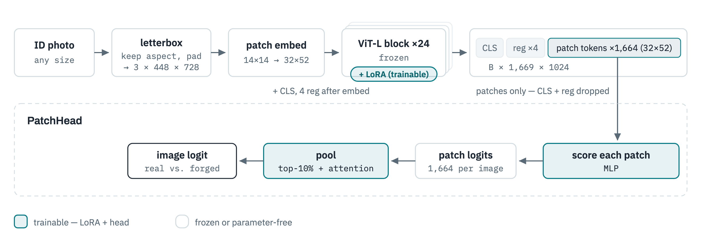
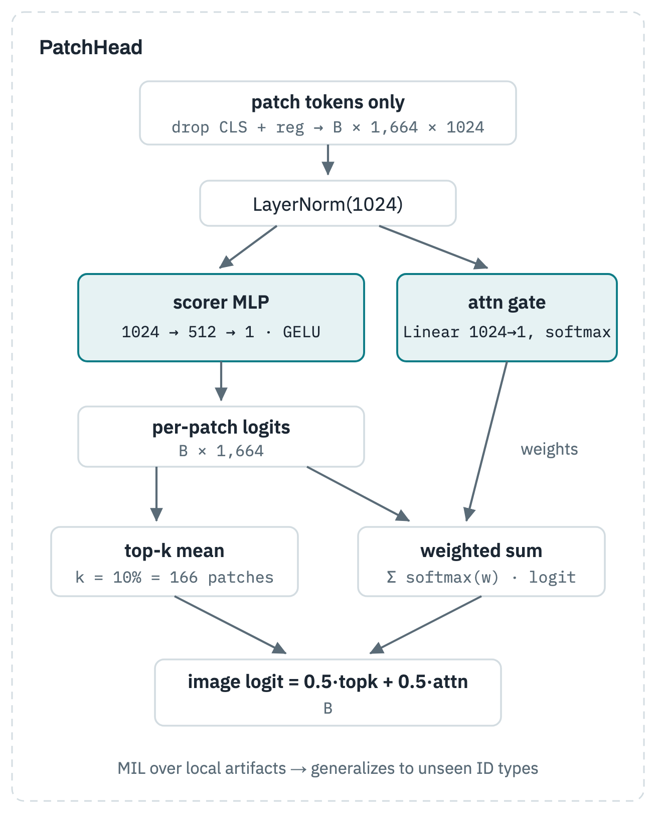

# Linear probing then fine-tuning improves out-of-distribution generalization on ViT-L but not ViT-B for identity-document fraud detection
## Abstract
Linear probing followed by fine-tuning (LP-FT) often leads to better out-of-distribution (OOD) generalization than fine-tuning (FT) alone. We tested both training methods on Vision Transformer (ViT) models for an identity-document fraud detection task that tests OOD generalization to unseen document types and capture methods. We find that LP-FT does improve OOD generalization on the ViT-L model but harms OOD generalization on the ViT-B variant. On the competition's private submission set, LP-FT took ViT-L from 0.1253 to 0.0936 and ViT-B from 0.1930 to 0.2405 (lower is better). The effect runs through the upper tail of genuine scores, which LP-FT lowered on ViT-L and raised on ViT-B. One candidate explanation is better pretrained features on ViT-L, which a one-epoch linear probe supports. 

## 1. Introduction
Fine-tuning a pretrained backbone with a randomly initialized head is a common recipe in transfer learning. However, a randomly initialized head needs large gradient updates, and training the head distorts the backbone features because the head and backbone gradients are coupled [5]. Consequently, the backbone and head converge to weights that fit the in-distribution (ID) training data but generalize poorly out-of-distribution (OOD). This feature distortion harms OOD performance under two conditions: (1) when the distribution shift between ID and OOD is large, and (2) when the pretrained features are good. Training the head first by linear probing (LP) and then fine-tuning (FT) aligns the head weights to the task before fine-tuning the backbone. The backbone then receives task-aligned gradients from the start rather than the large, misaligned ones a random head produces. Empirically, LP-FT cuts feature change by 10× to 100× on the benchmarks of [5] and gains about 10 percentage points on average on OOD sets [5].

We tested whether the OOD generalization gains of LP-FT translate to an identity-document fraud detection task from the FREUID Kaggle competition [2]. The competition scores generalization to document types and capture methods absent from training, the regime in which LP-FT is expected to help. 

We trained ViT-L and ViT-B models with low-rank adaptation (LoRA) adapters and a classification head under the two training methods, FT and LP-FT. We evaluated two backbone sizes to see how feature quality affects the OOD generalization gains of LP-FT. The backbones are DINOv2 models with registers [11], pretrained on the same data and distilled from the same ViT-g teacher [3], and only differ in capacity.

We evaluated the models on one ID set and two OOD sets. The ID set is a validation set we constructed from four open-source identity-document fraud detection datasets. It contains the same document types as the training set but unseen images. 

The two OOD sets are the generalization validation set and the private submission set. The generalization validation set was constructed from unseen document types from the same four sources as the training and validation sets. The private submission set is the dataset the competition used to evaluate the models and it contains document types unseen during training and different document capture methods.

**Contributions.**
1. A 2×2 comparison of FT and LP-FT on ViT-B and ViT-L, each evaluated on one in-distribution set and two out-of-distribution sets.
2. An observed interaction between head initialization and backbone size under distribution shift: LP-FT improves ViT-L and worsens ViT-B on both OOD sets.
3. The mechanism at the operating point: LP-FT moves the upper tail of genuine scores down on ViT-L and up on ViT-B, which one shared threshold converts into attacks caught or missed.
4. A feature-change measurement showing that LP-FT moves backbone features less than FT on both backbones, consistent with feature preserving effect of LP-FT.

## 2. Experimental setup
### 2.1 The model
Our model architecture and training configuration are adapted from the competition's winning solution [1]. We train a DINOv2 [3] ViT-B/14 or ViT-L/14 [6], loaded through timm [7], with the backbone frozen and LoRA adapters [4] of rank 16 on every attention and MLP projection. On top sits a classification head: a two-layer scorer gives each patch token a forgery (attack) logit, and the image logit is the average of two aggregations, the mean of the top 10 % of patch logits and an attention-weighted mean whose weights come from a learned linear gate over the same tokens. All models minimize focal binary cross-entropy [12] on the image logit (attack positive, α = 0.25, γ = 2). The α term weights a genuine scored as an attack three times a missed attack, a weighting toward the genuine tail that the metric's APCER@1%BPCER term also emphasizes.

Figure 1. Model diagram, drawn for ViT-L; ViT-B has 12 blocks and width 768. ID photo is letterboxed on a black canvas, keeping the aspect ratio, then normalized. Then the image is split into a total of 32 x 52 = 1,664 patches of 14x14 pixels. Each patch is linearly projected into tokens. The patch tokens are fed into the ViT model. In the PatchHead, we take the patch embeddings from the final layers of the ViT model, compute the per-patch logit and aggregate them to get an image level logit.

Figure 2. Classification head diagram. Each patch is scored independently with an MLP to get per-patch logits. The per-patch logits are aggregated to get the image level logit, the average of the top 10% mean of patch logits and the attention-weighted mean of patch logits.

### 2.2 Training method for FT and LP-FT
For LP-FT, we train only the head for one epoch and then train the head and the backbone's LoRA adapters for five epochs. During head-only training, the LoRA adapters are frozen at their initialization, where the B matrix is zero, so the backbone output is exactly the frozen DINOv2 features and the head sees pretrained features. The head trains with its own AdamW optimizer at the head's fine-tuning learning rate and weight decay, held constant for the epoch. The LP epoch then ends, a fresh optimizer and schedule start, the adapters are unfrozen, and the unchanged five-epoch recipe runs from the probed head. 

For FT, we train the head and LoRA adapters together for five epochs. 

The epoch-selection metric is a two-level macro: the FREUID score per type, averaged within each source, then averaged over sources, so no source dominates by count. Its 95 % interval is a type-stratified bootstrap over images. The epoch kept is the earliest whose selection-metric score falls inside the best epoch's interval; every run's selected epoch was epoch 4. The selection metric is computed on the generalization validation set.

Training configuration and cost are in Appendix A.

### 2.3 Metric
The FREUID score = 1 − harmonic mean of (1 − AuDET) and (1 − APCER@1%BPCER), lower is better. AuDET = 1 − ROC-AUC (attack positive). APCER@1%BPCER is the attack presentation classification error rate at a 1 % bona fide presentation classification error rate: the fraction of attacks missed at the threshold that rejects 1 % of genuines. AuDET is rank-based; the APCER term lives in the tail: the ordering of the highest-scored genuines against the lowest-scored attacks is what moves it.

### 2.4 The data: sources and splits
Four public sources (FREUID [2], FantasyID [9], SIDTD [10], IDNet v2 [8]) were ingested to create an aggregate dataset of 48 document types. From these, 37 document types form the training and validation sets. The remaining 11 document types compose the unseen-type holdout, the generalization validation set. The training and validation sets are drawn from the same distribution; the generalization validation set and the private submission set are the two OOD sets defined in §1.

| source | what it is | capture | train / validation / generalization validation images | types train+validation / generalization validation |
|---|---|---|---|---|
| FREUID | the competition's training set: synthetic templates, digital renders; digital and physical manipulations as attacks | digital render | 42,788 / 10,697 / 15,867 | 4 / 1 (EGYPT/DL held out) |
| IDNet v2 | as-shipped Zenodo release: real government templates content-erased by inpainting, synthetic faces and text; four digital manipulation families | digital render, no capture step | 11,970 / 3,030 / 5,000 | 15 / 5 (esp, fin, rus, az, ca) |
| SIDTD | MIDV-2020 mock cards, forged digitally, then laser-printed, laminated and video-captured on smartphones; frames cropped to the card | physical print and capture | 6,540 / 1,700 / 367 | 7 / 3 (esp_id, fin_id, rus_internalpassport) |
| FantasyID | 362 synthetic cards across 13 templates, photographed on two phones and a scanner; face-swap and text-diffusion attacks | physical print and capture | 2,084 / 534 / 666 | 11 / 2 (portugal, turkiye) |
| **total** | | | **63,382 / 15,961 / 21,900** | **37 / 11** |

Split construction (leakage grain per source) and label balance per source are in Appendix C.

## 3. Results: FT vs LP-FT on three evaluation sets
**Experiment protocol.** We evaluated the four models (ViT-L and ViT-B with FT and LP-FT) on the three evaluation sets (one ID set, two OOD sets). Every set is scored the same way: the FREUID score computed once over the whole set (the pooled score). For APCER@1%BPCER, one threshold is set by all of that set's genuines together. The intervals on the generalization validation set are type-stratified bootstraps over images; the validation set and the private submission set have none. Every model is scored at its training readout, the head's inference-time aggregation settings: top-k fraction 10 % and aggregation weight 0.5 (§2.1), held fixed so that only backbone and LP-FT differ between models.

**Results.** The pooled score is the headline for two reasons. It is how the private set is scored: one FREUID metric over the whole submission, so one APCER threshold set by all genuines together. And it is the operating condition of a deployed detector, which sets one threshold without knowing the document type, since the types that matter are the ones it has not seen. We pre-registered the per-type macro of §2.2 as the selection metric instead; it gives the opposite sign on ViT-B (§4.2, Appendix D), and we adopted the pooled score as the headline after the private results exposed that mismatch. On ViT-L, LP-FT does better than FT on both OOD sets: LP-FT/FT score ratio 0.67 on the generalization validation set with disjoint intervals, 0.75 on the private submission set. On ViT-B, LP-FT does worse than FT on both OOD sets: LP-FT/FT score ratio 1.16 on the generalization validation set with disjoint intervals, 1.25 on the private submission set.

**Table 1a. ViT-L**

| training | validation set | generalization validation set [95 % CI] | private submission set (public split) |
|---|---|---|---|
| FT | 0.0018 | 0.0399 [0.0369, 0.0431] | 0.1253 (0.0562) |
| LP-FT | 0.0035 | **0.0267** [0.0244, 0.0294] | **0.0936** (0.0268) |

**Table 1b. ViT-B**

| training | validation set | generalization validation set [95 % CI] | private submission set (public split) |
|---|---|---|---|
| FT | 0.0064 | **0.0745** [0.0693, 0.0802] | **0.1930** (0.1344) |
| LP-FT | 0.0049 | 0.0866 [0.0818, 0.0932] | 0.2405 (0.1208) |

## 4. Analysis
### 4.1 LP-FT's effect under shift depends on the backbone, in the direction feature quality predicts
LP-FT helped ViT-L and hurt ViT-B on both OOD sets. One possible explanation is that the ViT-L pretrained features are better for the task than the ViT-B pretrained features.

Under the feature-distortion account [5], LP-FT pays off when the pretrained features are already good for the task, because LP-FT preserves the pretrained features (tested in §4.4): a head fitted to the pretrained features keeps the early fine-tuning gradients small and task-aligned, so the feature directions that matter out-of-distribution survive, and that is only worth something if those directions were there to begin with. 

We measured the quality of the pretrained features by comparing the linear-probe-only score for both models. We trained a classification head on each frozen backbone for one epoch. Then we evaluated the models on the validation and generalization validation set. The ViT-L model outperformed the ViT-B model on both sets: 0.1438 vs 0.2441 on the generalization validation set and 0.1065 vs 0.1288 on the validation set (lower is better). However, two limitations are that one epoch is not a converged probe, and both probes are an order of magnitude behind their fine-tuned models, so the task needs adaptation on either backbone.

### 4.2 Per-type and one-threshold scoring disagree on ViT-B
The same generalization validation predictions give a different sign for LP-FT on ViT-B depending on whether each document type gets its own threshold or all types share one. Under per-type thresholds (the two-level macro of §2.2), LP-FT outperformed FT on ViT-B, 0.0451 [0.0391, 0.0551] vs 0.1068 [0.0954, 0.1158], a gain with disjoint intervals, and left the ViT-L intervals overlapping (0.0365 [0.0245, 0.0442] against 0.0284 [0.0249, 0.0330]). Under one threshold (§3), LP-FT performed worse than FT on ViT-B and better than FT on ViT-L. 

Per source, under per-type thresholds, LP-FT's gain on ViT-B came from FantasyID (0.292 to 0.040), offset by a loss on IDNet (0.099 to 0.128). Under a single threshold that gain is outweighed by the cross-source threshold shift described in §4.3. 

On ViT-B, LP-FT improves separation within each type but worsens the alignment of score scales across types.

### 4.3 Where the effect lives: the upper tail of FREUID's genuine scores
The metric's second term is the fraction of attacks missed at the threshold that rejects 1 % of genuines. FREUID's held-out type supplies 73 % of the generalization validation set's genuines, so under one threshold the operating point is set largely by the upper tail of FREUID's genuine scores. We measured how FT and LP-FT affect the upper tail of FREUID's genuine scores and consequently the pooled threshold for each model. LP-FT moved that tail and the pooled threshold in opposite directions on the two backbones.

**Table 2a. ViT-L**

| training | FREUID genuine 99th percentile | pooled threshold | attacks missed by source: IDNet / FantasyID / SIDTD |
|---|---|---|---|
| FT | 0.791 | 0.779 | 23 % / 9 % / 6 % |
| LP-FT | 0.532 | 0.619 | 18 % / 8 % / 5 % |

**Table 2b. ViT-B**

| training | FREUID genuine 99th percentile | pooled threshold | attacks missed by source: IDNet / FantasyID / SIDTD |
|---|---|---|---|
| FT | 0.752 | 0.773 | 23 % / 34 % / 6 % |
| LP-FT | 0.908 | 0.895 | 45 % / 40 % / 18 % |

On ViT-B, LP-FT pushed the hardest FREUID genuines up toward the attack scores. The 99th percentile score of FREUID genuines increases from 0.752 to 0.908 (Table 2b). Within FREUID that costs nothing: LP-FT raised the attack scores more than the genuine tail, so a FREUID-only threshold still falls below the attacks and the within-FREUID score improves (0.037 to 0.012). However, under one threshold, the same movement drags the operating point up for every source, and the attacks from other sources scoring between the old and new thresholds flip from caught to missed. On ViT-L, LP-FT pushed the same tail down, the shared threshold falls, and more attacks are caught. 

### 4.4 Does LP-FT preserve the features?
Under the feature-distortion account of [5], a randomly initialized head distorts the features of the backbone. As a corollary, we expect that: (1) LP-FT moves features less than FT; (2) under FT, ID features move more than OOD features. We tested this on our three sets.

The frozen DINOv2 backbone and the fine-tuned (FT or LP-FT) backbone are run on the same image, and the per-image feature change is the mean over the 1,664 patch tokens of ‖trained − frozen‖ / ‖frozen‖. The images are fixed before the run: 1,000 validation set and 1,000 generalization validation set images, each stratified by document type, and 1,000 private submission set images drawn uniformly. Tables 3a and 3b report the mean per-image movement with a 95 % bootstrap interval over the 1,000 images, one seed per model. A value of 1.0 means the average patch token moved by its own length. 

**Table 3a. ViT-L**

| training | validation set | generalization validation set | private submission set |
|---|---|---|---|
| FT | 0.981 [0.974, 0.989] | 0.929 [0.920, 0.938] | 0.994 [0.985, 1.002] |
| LP-FT | 0.704 [0.700, 0.708] | 0.645 [0.643, 0.647] | 0.665 [0.662, 0.669] |

**Table 3b. ViT-B**

| training | validation set | generalization validation set | private submission set |
|---|---|---|---|
| FT | 0.960 [0.953, 0.966] | 0.847 [0.844, 0.851] | 0.913 [0.906, 0.919] |
| LP-FT | 0.750 [0.747, 0.753] | 0.700 [0.699, 0.702] | 0.704 [0.701, 0.708] |

FT changes the features more than LP-FT on both backbones on all three sets.

FT changes the features more on ID than OOD for both OOD sets on ViT-B but only on one set for ViT-L.
LP-FT changes the features more on ID than OOD for both backbones and both OOD sets.

### 4.5 The cost question that started the program
Under per-type scoring, LP-FT had put ViT-B inside ViT-L's interval at 2.9× the training throughput. Under the pooled score and on the private submission set it did not: ViT-B + LP-FT is the worst of the four models, worse than ViT-B without LP-FT and 2.6× worse than ViT-L + LP-FT. The large backbone, which the question hoped to replace, is the one LP-FT helped, and ViT-L + LP-FT has the lowest private submission set score.

## 5. Limitations
- One seed per model; generalization validation set intervals are over images, not training randomness; private submission set numbers have no interval at all.
- The fixed readout costs the ViT-B models more than the ViT-L models (Appendix B), so any comparison across backbones carries some readout in it.
- The feature-change measurement (§4.4) is one seed per model on 1,000 images per set.
- The generalization validation set is both the epoch-selection set (§2.2) and one of the two reported OOD sets, so its scores are mildly optimistic for every model. The selection rule is the earliest epoch inside the best epoch's interval and every model's selected epoch was epoch 4, so the bias is small and the same for all four models, but it is not zero.
- The LP-FT models train for six epochs (one head-only, five full) against five for the FT models. The extra epoch is a compute confound in LP-FT's favor: it makes the ViT-B result (LP-FT worse) more credible and the ViT-L result (LP-FT better) slightly less.

## 6. Conclusion

LP-FT outperformed FT for ViT-L on both out-of-distribution sets and FT outperformed LP-FT for ViT-B on both. Whether LP-FT helped tracked the backbone, which we take as a proxy for pretrained feature quality; the probe comparison supports this, but one seed per model leaves it a hypothesis.  

The result on the generalization validation set depends on the aggregation. Our pre-registered selection metric, the per-type macro, was mis-specified relative to the target: it sets a threshold per document type, which a deployed detector or the competition's pooled scoring never does, and it called the ViT-B pair the wrong way. A selection metric should share the target's thresholding, not only its formula. The mechanism at the operating point is that LP-FT moved the upper tail of FREUID genuine scores up on ViT-B and down on ViT-L, which one shared threshold converts into attacks from the three non-FREUID sources missed or caught.

## Appendix A. Training configuration and cost
Images are letterboxed to 448×728. Training runs five epochs at batch 6 with gradient accumulation 4, fp16, focal binary cross-entropy. The ViT-L variant has 304M backbone parameters and 6.29M adapter parameters; ViT-B has 86M and proportionally fewer. Nothing about the head, the adapters or the schedule changes between runs. The LP-FT runs add one head-only epoch before the five. One g5.4xlarge (A10G, 24 GB) per run.

| run | throughput (img/s) | wall time |
|---|---|---|
| ViT-L, FT | 12.1 | 9 h 27 |
| ViT-L, LP-FT | 12.1 | 10 h 37 |
| ViT-B, FT | 34.9 | 3 h 17 |
| ViT-B, LP-FT | ≈ 34.9 | 3 h 44 |

ViT-B trains at 2.9× ViT-L's throughput; the LP epoch adds 12 to 14 % to wall time on either backbone. Inference at the fixed readout on the 142,818 submission images took 2,034 s on ViT-B and 5,718 s on ViT-L, 2.8×.

## Appendix B. Cost of the fixed readout
The cost of the fixed readout on the generalization validation set, relative to each model's best swept readout there: fixing the top-k fraction and weight costs each model less than its own interval (ViT-L 0.0321 → 0.0365, ViT-B + LP-FT 0.0419 → 0.0451); dropping test-time augmentation (TTA) costs ViT-L 0.0275 → 0.0365 with overlapping intervals but ViT-B + LP-FT 0.0310 → 0.0451 with disjoint ones. The fixed readout therefore handicaps the ViT-B models more than the ViT-L models on the generalization validation set.

## Appendix C. Split construction and label balance
The leakage grain differs by source because the sources repeat documents differently. FREUID rows are independent renders and are split directly, stratified by type. IDNet v2 is split 80:20 stratified per country and manipulation folder. SIDTD frames come from video clips of a physical document, and each fake is a manipulation of a base real document, so all frames and fake variants of one base document stay on one side; the training and validation sets keep ten frames per document and the generalization validation set one frame per document, so near-duplicate frames do not inflate per-document metrics. FantasyID shows the same physical card about nine times across devices and attack variants, so all variants of one card stay on one side. All splits use seed 42.

Label balance is 60:40 genuine to attack in the training and validation sets and 50:50 in the generalization validation set, but it varies by source: FantasyID is 70 % attack, SIDTD 14 to 18 % attack, IDNet and FREUID near half. FREUID is 68 % of all rows and 72.5 % of the generalization validation set, which is why the pooled and macro numbers there (§4.2) can disagree. Two external sources sit on the physical side of the capture axis and two on the digital side; the competition's private submission set is FREUID with unseen document types and print-and-capture images in an unstated proportion.

## Appendix D. Five aggregations of the generalization validation predictions
The four models' generalization validation predictions were re-scored post hoc under five aggregations, each with the type-stratified bootstrap and with the decision tree for reading the result written before it was run. The macro was the pre-registered selection metric; the pooled score was logged for every epoch of every run from the start, but reporting it as the headline (§3) is a choice made after the private scores existed.

**Table D1a. ViT-L**

| training | macro: per-type thresholds, mean within then across sources (§2.2) | per-type thresholds, image-weighted mean | one threshold per source, mean across sources | pooled: one threshold over all 21,900 images (§3) | pooled over the three external sources only |
|---|---|---|---|---|---|
| FT | 0.0365 | 0.0216 | 0.0435 | 0.0399 | 0.0890 |
| LP-FT | 0.0284 | 0.0229 | 0.0416 | **0.0267** | 0.1243 |
| LP-FT vs FT | overlap | overlap | overlap | **LP-FT better, disjoint** | LP-FT worse, disjoint |

**Table D1b. ViT-B**

| training | macro: per-type thresholds, mean within then across sources (§2.2) | per-type thresholds, image-weighted mean | one threshold per source, mean across sources | pooled: one threshold over all 21,900 images (§3) | pooled over the three external sources only |
|---|---|---|---|---|---|
| FT | 0.1068 | 0.0580 | 0.1561 | **0.0745** | 0.2285 |
| LP-FT | 0.0451 | 0.0391 | 0.0939 | 0.0866 | 0.2223 |
| LP-FT vs FT | LP-FT better, disjoint | LP-FT better, disjoint | LP-FT better, disjoint | **LP-FT worse, disjoint** | overlap |

Only the pooled aggregation orders both pairs as the private submission set did, and it does so with disjoint intervals on both. Per-type thresholding alone and source weighting alone each keep the macro's ordering, and pooling the three external sources without FREUID does not reproduce it either. The agreement comes from one threshold set across FREUID and the external sources together.

## References

1. N. Hasan, *FREUID Challenge 2026 — 1st place solution*, github.com/nadhirhasan/FREUID-Challenge-2026 (MIT), 2026.
2. The FREUID Challenge 2026 (IJCAI-ECAI 2026), kaggle.com/competitions/the-freuid-challenge-2026-ijcai-ecai.
3. M. Oquab et al., *DINOv2: Learning Robust Visual Features without Supervision*, arXiv:2304.07193, 2023.
4. E. Hu et al., *LoRA: Low-Rank Adaptation of Large Language Models*, arXiv:2106.09685, 2021.
5. A. Kumar, A. Raghunathan, R. Jones, T. Ma, P. Liang, *Fine-Tuning can Distort Pretrained Features and Underperform Out-of-Distribution*, ICLR 2022, arXiv:2202.10054.
6. A. Dosovitskiy et al., *An Image is Worth 16×16 Words*, ICLR 2021, arXiv:2010.11929.
7. R. Wightman, *timm: PyTorch Image Models*, github.com/huggingface/pytorch-image-models.
8. H. Guan, Y. Wang, L. Xie, S. Nag, R. Goel, N. Erappa Narayana Swamy, Y. Yang, C. Xiao, J. Prisby, R. Maciejewski, J. Zou, *IDNet: A Novel Dataset for Identity Document Analysis and Fraud Detection*, arXiv:2408.01690, 2024. Data: IDNet v2 (Sept-2024 release), Zenodo records 13852263, 13852274, 13852734, 13852757, 13854897, 13854938, 13855052, 13855175.
9. P. Korshunov, A. Mohammadi, Vidit, C. Ecabert, S. Marcel, *FantasyID: A Dataset for Detecting Digital Manipulations in ID-Documents*, IEEE International Joint Conference on Biometrics (IJCB), 2025, doi:10.1109/IJCB65343.2025.11411292.
10. C. Boned, M. Talarmain, N. Ghanmi, G. Chiron, S. Biswas, A. M. Awal, O. Ramos Terrades, *Synthetic dataset of ID and Travel Documents*, Scientific Data 11, 1356, 2024, doi:10.1038/s41597-024-04160-9.
11. T. Darcet, M. Oquab, J. Mairal, P. Bojanowski, *Vision Transformers Need Registers*, ICLR 2024, arXiv:2309.16588.
12. T.-Y. Lin, P. Goyal, R. Girshick, K. He, P. Dollár, *Focal Loss for Dense Object Detection*, ICCV 2017, arXiv:1708.02002.
